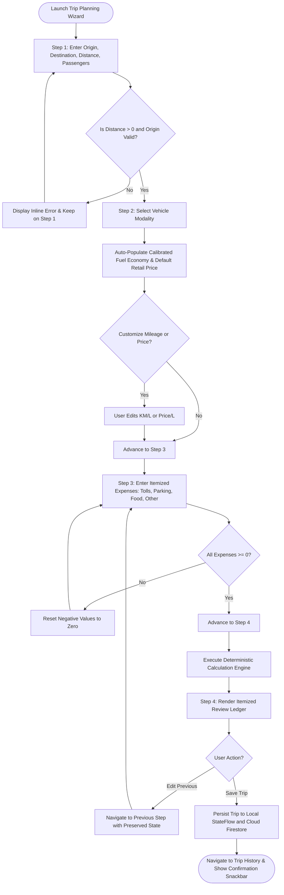
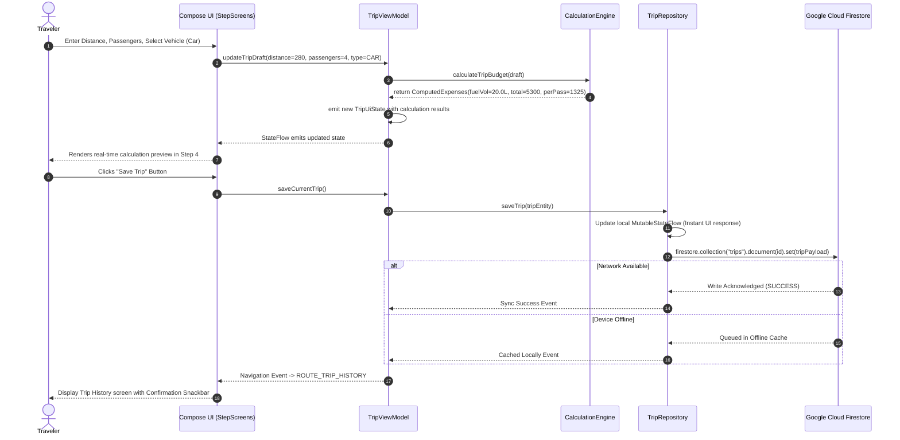
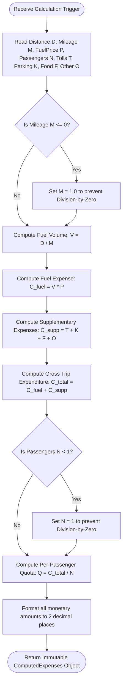
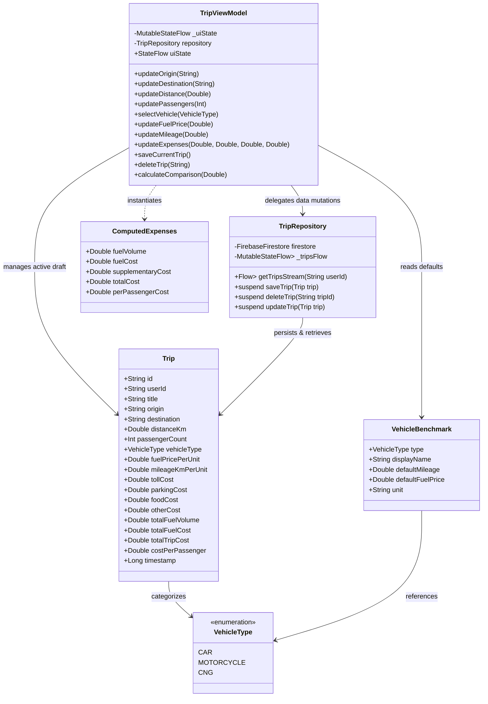

# CHAPTER 4: SYSTEM ANALYSIS AND DESIGN

## 4.1 System Analysis

System analysis is the systematic process of dissecting the problem domain, identifying operational boundaries, formalizing data transformations, and establishing structural models that satisfy the functional and non-functional requirements established in the SRS. For **TripWise: Smart Vehicle & Trip Cost Planner**, the analysis phase focused on decomposing the multi-variable problem of road journey cost estimation into discrete mathematical, behavioral, and structural abstractions.

Key findings from the system analysis include:
1. **State Isolation:** The workflow of trip budgeting is inherently staged. A progressive 4-step wizard reduces cognitive load by decoupling spatial destination entry from vehicle powertrain selection and itemized expense accounting.
2. **Deterministic Computations:** All mathematical formulations for fuel consumption, gross expenditure, and passenger splitting are deterministic; they require real-time recalculation upon any parameter mutation without network roundtrip dependencies.
3. **Hybrid Persistence:** While calculations operate instantaneously in memory, user itineraries, historical analytics, and profile metadata require cloud synchronization with offline survivability.
4. **Contextual Highway Utility Needs:** Highway driving requires on-demand access to bridge toll matrices, speed limits, and emergency dispatch, necessitating dedicated utility views linked to the main dashboard.

---

## 4.2 Proposed System Architecture

TripWise is architected following the **Clean Architecture** paradigm combined with the **Model-View-ViewModel (MVVM)** design pattern recommended by the official Android Architecture Guidelines. This pattern enforces strict separation of concerns, high cohesion, low coupling, and testability.


*Figure 4.1: TripWise Clean System Architecture & Layered Interaction Model.*

```
+-----------------------------------------------------------------------------------+
|                                 PRESENTATION LAYER                                |
|  +-----------------------------------------------------------------------------+  |
|  | Jetpack Compose Declarative UI Components (Material 3)                      |  |
|  | - HomeScreen, StepperScreens (Step 1-4), CompareScreen, HistoryScreen,       |  |
|  |   AnalyticsScreen, UtilitiesScreens (RouteMap, QrTicket, VideoGuide)        |  |
|  +-----------------------------------------------------------------------------+  |
|                                       | Observes StateFlow (UI State)             |
|                                       v Emits User Actions (Events)               |
|  +-----------------------------------------------------------------------------+  |
|  | TripViewModel (State Management & Reactive UI Coordination)                 |  |
|  | - Holds MutableStateFlow<TripUiState>, TripDraft, VehicleBenchmarks        |  |
|  | - Dispatches asynchronous coroutines via viewModelScope                     |  |
|  +-----------------------------------------------------------------------------+  |
+---------------------------------------|-------------------------------------------+
                                        | Invokes Domain & Data Operations
                                        v
+-----------------------------------------------------------------------------------+
|                                    DOMAIN LAYER                                   |
|  +-----------------------------------------------------------------------------+  |
|  | Pure Business Logic & Mathematical Computation Engine                       |  |
|  | - FuelVolumeCalculator, TripExpenseCalculator, PassengerSplitter,           |  |
|  |   VehicleComparisonEngine                                                   |  |
|  +-----------------------------------------------------------------------------+  |
+---------------------------------------|-------------------------------------------+
                                        | Interacts via Repository Abstraction
                                        v
+-----------------------------------------------------------------------------------+
|                                    DATA LAYER                                     |
|  +-----------------------------------------------------------------------------+  |
|  | TripRepository (Single Source of Truth / Data Synchronization)              |  |
|  +-----------------------------------------------------------------------------+  |
|         |                                              |                          |
|         v (Local Cache & Reactive Memory)              v (Remote Cloud Sync)      |
|  +---------------------------+                +--------------------------------+  |
|  | InMemory Cache / DataStore|                | Google Cloud Firestore SDK     |  |
|  | (Instant offline access)  |                | (Persistent Cloud Collections) |  |
|  +---------------------------+                +--------------------------------+  |
+-----------------------------------------------------------------------------------+
```

### Architectural Layer Responsibilities
- **Presentation Layer (UI & ViewModel):** Implemented using Jetpack Compose and Material Design 3. UI composables are stateless functions that render UI based solely on immutable `TripUiState` emitted by `TripViewModel`. User events (text edits, button clicks) are delegated upwards to the ViewModel.
- **Domain Layer (Business Models & Math Logic):** Houses the core calculation algorithms, vehicle benchmark models, and validation rules. This layer contains pure Kotlin code free of Android framework dependencies, ensuring high portability and rapid unit testing.
- **Data Layer (Repository & Cloud Sources):** Coordinates data operations across local in-memory storage and Google Cloud Firestore. The `TripRepository` implements proactive caching: trips are saved immediately to local memory flows for zero-latency UI rendering, while an asynchronous coroutine dispatches the serialized payload to Cloud Firestore.

---

## 4.3 Architectural Design

The architectural design emphasizes **Unidirectional Data Flow (UDF)**:
1. **State Flows Down:** The ViewModel exposes a single, immutable `StateFlow<TripUiState>` to the Compose presentation layer.
2. **Events Flow Up:** User interactions (e.g., changing distance, clicking Next, toggling vehicle type) are transmitted to the ViewModel as explicit method invocations (e.g., `updateDistance(km)`, `saveCurrentTrip()`).
3. **Reactive Recomposition:** When the ViewModel mutates its internal private `MutableStateFlow`, Jetpack Compose detects the state mutation and intelligently recomposes only the affected UI nodes.

---

## 4.4 Use Case Diagram

The Use Case Diagram formalizes the primary interactions between the primary actor (**Traveler / User**) and secondary actor (**Firebase / Cloud Backend**) with the TripWise system.


*Figure 4.2: TripWise Formal UML Use Case Diagram.*

```mermaid
flowchart TD
    User([Traveler / End User])
    Backend([Google Cloud / Firebase])

    subgraph TripWise Application
        UC01[UC-01: Plan Journey via 4-Step Wizard]
        UC02[UC-02: Compare Multi-Modal Vehicle Costs]
        UC03[UC-03: View and Manage Trip History]
        UC04[UC-04: View Aggregated Trip Analytics]
        UC05[UC-05: Access Highway & Toll Utilities]
        UC06[UC-06: Dispatch Emergency Helplines]
        UC07[UC-07: User Authentication & Profile]
        
        UC01A((Enter Origin & Destination))
        UC01B((Select Vehicle Modality))
        UC01C((Itemize Tolls & Expenses))
        UC01D((Calculate & Review Ledger))
        UC01E((Save Trip to Cloud))
        
        UC05A((View Route Waypoint Map))
        UC05B((Generate RFID/QR Toll Pass))
        UC05C((Review Padma Bridge Rules))
    end

    User --> UC01
    User --> UC02
    User --> UC03
    User --> UC04
    User --> UC05
    User --> UC06
    User --> UC07

    UC01 ..> UC01A : <<include>>
    UC01 ..> UC01B : <<include>>
    UC01 ..> UC01C : <<include>>
    UC01 ..> UC01D : <<include>>
    UC01 ..> UC01E : <<include>>

    UC05 ..> UC05A : <<extend>>
    UC05 ..> UC05B : <<extend>>
    UC05 ..> UC05C : <<extend>>

    UC01E --> Backend
    UC03 --> Backend
    UC07 --> Backend
```

---

## 4.5 Use Case Descriptions

The system's core capabilities are formalized through detailed use case specifications:

### Table 4.1: Use Case Specification — UC-01: Plan Journey via 4-Step Wizard
| Use Case Attribute | Specification Details |
| :--- | :--- |
| **Use Case ID & Name** | **UC-01: Plan Journey via 4-Step Wizard** |
| **Primary Actor** | Traveler / App User |
| **Secondary Actor** | Google Cloud Firestore Backend |
| **Pre-Conditions** | Application launched and displayed on Home Screen. |
| **Post-Conditions** | Trip expenses calculated, reviewed, and persisted to local and cloud storage. |
| **Main Success Scenario** | 1. User selects "Plan New Trip" on Home Screen.<br>2. System navigates to Step 1 (Trip Details); User enters Origin, Destination, Distance ($KM$), and Passengers ($N$).<br>3. User clicks "Next"; System validates input and navigates to Step 2 (Vehicle Selection).<br>4. User selects vehicle modality (Car, Bike, CNG); System auto-loads calibrated fuel economy and price.<br>5. User clicks "Next"; System navigates to Step 3 (Expenses); User enters Toll, Parking, Food, and Other costs.<br>6. User clicks "Next"; System renders Step 4 (Review); System displays itemized calculation ledger (Fuel volume, gross cost, per-passenger quota).<br>7. User clicks "Save Trip"; System saves document to Firestore and navigates to History. |
| **Extensions (Alternate Flows)** | **2a. Blank Origin or Invalid Distance:** System highlights text field with red inline error message and disables "Next Step" button.<br>**7a. Device Offline:** System writes trip immediately to local repository and queues Firestore sync for when connectivity is restored. |

### Table 4.2: Use Case Specification — UC-02: Compare Multi-Modal Vehicle Costs
| Use Case Attribute | Specification Details |
| :--- | :--- |
| **Use Case ID & Name** | **UC-02: Compare Multi-Modal Vehicle Costs** |
| **Primary Actor** | Traveler / App User |
| **Pre-Conditions** | User navigates to "Compare Vehicles" screen from Home or Navigation Drawer. |
| **Post-Conditions** | System computes and renders side-by-side fuel volume, total financial outlay, and savings delta. |
| **Main Success Scenario** | 1. User enters or adjusts distance in kilometers (e.g., $250\text{ km}$).<br>2. System executes simultaneous calculation for Sedan Car ($14\text{ km/L}$), Motorcycle ($40\text{ km/L}$), and CNG Auto-Rickshaw ($28\text{ km/m}^3$).<br>3. System displays comparative cards showing exact fuel liters/$\text{m}^3$ and monetary outlays.<br>4. System highlights the most economical vehicle and displays percentage savings versus the most expensive option. |

### Table 4.3: Use Case Specification — UC-03: View and Manage Trip History
| Use Case Attribute | Specification Details |
| :--- | :--- |
| **Use Case ID & Name** | **UC-03: View and Manage Trip History** |
| **Primary Actor** | Traveler / App User |
| **Secondary Actor** | Google Cloud Firestore Backend |
| **Pre-Conditions** | User navigates to History screen. |
| **Post-Conditions** | Historical trips rendered reactively; deleted trips purged from cloud database. |
| **Main Success Scenario** | 1. System listens to Firestore collection `/trips` filtered by `userId`.<br>2. System renders historical trip cards sorted chronologically.<br>3. User taps a trip to view detailed breakdown or taps delete icon.<br>4. Upon deletion confirmation, System deletes document from Firestore and updates list reactively. |

### Table 4.4: Use Case Specification — UC-05: Access Highway Transit Utilities
| Use Case Attribute | Specification Details |
| :--- | :--- |
| **Use Case ID & Name** | **UC-05: Access Highway Transit Utilities** |
| **Primary Actor** | Highway Driver / Traveler |
| **Pre-Conditions** | User selects a smart utility card from the Home Screen dashboard. |
| **Post-Conditions** | Selected utility module loaded with interactive domain content. |
| **Main Success Scenario** | 1. User selects "Route Map", "Toll Pass", "Padma Bridge Guide", or "Emergency Contacts".<br>2. System transitions to selected screen, rendering waypoint markers, simulated QR RFID barcode, statutory speed camera advisories, or direct telephone dialer links. |

---

## 4.6 Activity Diagram

The Activity Diagram models the dynamic operational workflow of the 4-step trip planning wizard, illustrating decision branching, validation gates, and asynchronous persistence.


*Figure 4.3: TripWise 4-Step Trip Planning Activity Diagram.*



---

## 4.7 Sequence Diagram

The Sequence Diagram illustrates the chronological message sequence and object collaboration across presentation, ViewModel, repository, and cloud tiers during trip calculation and storage.


*Figure 4.4: TripWise End-to-End Sequence Diagram.*



---

## 4.8 Data Flow Diagrams (DFD)

### 4.8.1 DFD Level 0 (Context Diagram)
The Context Diagram establishes the highest-level data transformation view, framing the application as a single transformation process interacting with external entities.

```
                  +-------------------------------------------------+
                  |                                                 |
                  |  Trip Planning Inputs (Distance, Vehicle, Tolls)|
                  |------------------------------------------------>|
+-------------+   |                                                 |   +-----------------------+
|             |   |  Real-Time Cost Breakdown & Split Quotas        |   |                       |
|   User /    |   |<------------------------------------------------|   |   TripWise System     |
|  Traveler   |   |                                                 |   |   Execution Engine    |
|             |   |  Emergency Dial Request / Transit Utilities     |   |                       |
|             |   |<------------------------------------------------|   |                       |
+-------------+   |                                                 |   +-----------------------+
                  +-------------------------------------------------+               |
                                                                                    |
                                   Document CRUD Operations (HTTPS/gRPC)            |
                                   <================================================>
                                                                                    |
                                                                        +-----------------------+
                                                                        | Google Cloud Firestore|
                                                                        | (tripwise-db)         |
                                                                        +-----------------------+
```

### 4.8.2 DFD Level 1 (Detailed Sub-Processes)
The Level 1 DFD decomposes the system into four interconnected sub-processes: Input Sanitization (P1), Mathematical Cost Computation (P2), Local State Management (P3), and Cloud Synchronization (P4).

```
   User Inputs
       |
       v
+-----------------------+
| P1: Input Validation  |---- Sanitized Trip Parameters ----+
|     & Sanitization    |                                   |
+-----------------------+                                   v
                                                 +-----------------------+
                                                 | P2: Mathematical Cost |
                                                 |     Calculation Engine|
                                                 +-----------------------+
                                                            |
                                             Calculated Financial Ledger
                                                            |
                                                            v
+-----------------------+  Immutable State Flow  +-----------------------+
| User Interface        |<-----------------------| P3: Local State &     |
| Presentation (Compose)|                        |     ViewModel Buffer  |
+-----------------------+                        +-----------------------+
                                                            |
                                                Trip Document Payload
                                                            |
                                                            v
                                                 +-----------------------+
                                                 | P4: Cloud Sync &      |
                                                 |     Firestore Writer  |
                                                 +-----------------------+
                                                            |
                                                            v
                                                 [D1: Firestore /trips Collection]
```

---

## 4.9 Calculation Flowchart

The calculation engine follows a deterministic algorithmic sequence when processing trip expenses:



---

## 4.10 Class Diagram / Component Architecture

The class diagram depicts the relationships, attributes, and operational contracts between the core structural entities within the TripWise application.



---

## 4.11 Entity-Relationship Diagram (ERD) & Database Schema

TripWise utilizes Google Cloud Firestore, a NoSQL document-oriented database. The relational structure and document schemas are represented in the Entity-Relationship Diagram below:


*Figure 4.5: TripWise Google Cloud Firestore NoSQL Entity-Relationship Schema.*

```
+--------------------------+             1:N             +--------------------------+
|         USERS            |----------------------------<|          TRIPS           |
| (Collection: /users)     |                             | (Collection: /trips)     |
+--------------------------+                             +--------------------------+
| * userId (PK, String)    |                             | * id (PK, String)        |
|   email (String)         |                             |   userId (FK, String)    |
|   displayName (String)   |                             |   origin (String)        |
|   photoUrl (String)      |                             |   destination (String)   |
|   createdAt (Timestamp)  |                             |   distanceKm (Double)    |
|   preferredVehicle (Str) |                             |   passengerCount (Int)   |
+--------------------------+                             |   vehicleType (String)   |
             |                                           |   fuelPrice (Double)     |
             | 1:N                                       |   mileage (Double)       |
             v                                           |   tollCost (Double)      |
+--------------------------+                             |   parkingCost (Double)   |
|         ORDERS           |                             |   foodCost (Double)      |
| (Collection: /orders)    |                             |   totalFuelVol (Double)  |
+--------------------------+                             |   totalTripCost (Double) |
| * orderId (PK, String)   |                             |   costPerPassenger (Dbl) |
|   userId (FK, String)    |                             |   timestamp (Timestamp)  |
|   items (Array<Map>)     |                             +--------------------------+
|   totalAmount (Double)   |
|   status (String)        |
|   createdAt (Timestamp)  |
+--------------------------+
```

### Table 4.5: Firestore Collections and Schema Specification

| Collection Name | Document ID Pattern | Key Fields and Data Types | Description & Security Policy |
| :--- | :--- | :--- | :--- |
| `/users` | `userId` (Firebase Auth UID) | `email` (string), `displayName` (string), `createdAt` (timestamp). | User profile records. Accessible only by the authenticated owner (`request.auth.uid == userId`). |
| `/trips` | Auto-generated UUID / Push ID | `id` (string), `userId` (string), `origin` (string), `destination` (string), `distanceKm` (number), `passengerCount` (number), `vehicleType` (string), `totalTripCost` (number), `costPerPassenger` (number), `timestamp` (timestamp). | Trip records generated by users. Read, write, and delete operations strictly restricted to document owner (`request.auth.uid == resource.data.userId`). |
| `/emergency_contacts` | Static Agency Identifier | `id` (string), `agencyName` (string), `phoneNumber` (string), `category` (string), `jurisdiction` (string). | Verified public transit emergency contacts. Publicly readable by all authenticated users; write restricted to administrators. |

---

## 4.12 UI/UX Design System and Styling Tokens

TripWise adheres strictly to the **Material Design 3 (M3)** specification. The design language emphasizes high readability, bold numerical focal points, spacious $8\text{ dp}$ grid alignment, and WCAG AA compliant contrast ratios.

### 4.12.1 Color Palette
- **Primary Color:** Deep Teal / Ocean Blue (`#006A6A` / `#006874`), conveying financial trust, precision, and tranquility.
- **Secondary Color:** Vibrant Slate / Sky (`#4A6267` / `#0288D1`), utilized for secondary chips, progress indicators, and active vehicle cards.
- **Modality Accent Colors:**
  - *Sedan Car:* Sapphire Blue (`#1E88E5`), symbolizing private commuter comfort.
  - *Motorcycle:* Forest Emerald (`#2E7D32`), signifying agility and fuel economy.
  - *CNG Auto-Rickshaw:* Amber Gold (`#F57F17`), reflecting the iconic regional paratransit livery.
- **Background & Surface:** High-contrast neutral surfaces (`#FBFDFD` in Light Mode, `#191C1D` in Dark Mode).

### 4.12.2 Typography Scale
TripWise employs modern Sans-Serif typography (Roboto / Inter) configured in the central Compose `Typography` definition:
- **Headline Large ($32\text{ sp}$, Bold):** Primary dashboard greeting and final gross trip cost ledger display.
- **Title Medium ($18\text{ sp}$, Medium):** Card headers, step titles, and vehicle category labels.
- **Body Large ($16\text{ sp}$, Regular):** Input text field entries and primary descriptive copy.
- **Label Small ($11\text{ sp}$, Medium):** Sub-bullet metadata, currency markers, and speed advisory tags.

---

## 4.13 Mathematical Formulation of Cost Calculation

The core computational engine of TripWise executes deterministic mathematical functions governing fuel volume, expenditures, and group cost allocations.

### 4.13.1 Fuel Volume Consumption Model
The total volume of fuel consumed for a journey of distance $D$ (measured in kilometers) by a vehicle possessing an engine fuel economy rating $M$ (measured in $\text{km/L}$ for petrol/octane or $\text{km/m}^3$ for CNG) is expressed as:

$$V = \frac{D}{M}$$

*Constraint:* $M > 0$. If $M \le 0$, the system applies a defensive fallback $M = 1.0$ to prevent an IEEE 754 division-by-zero error.

### 4.13.2 Gross Fuel Expenditure Model
Let $P_f$ denote the retail unit price of fuel (expressed in local currency BDT per liter or per $\text{m}^3$). The gross financial expenditure incurred solely for fuel consumption $C_{\text{fuel}}$ is:

$$C_{\text{fuel}} = V \times P_f = \left(\frac{D}{M}\right) \times P_f$$

### 4.13.3 Supplementary Travel Expenses Model
Supplementary road expenses are itemized into four mutually exclusive operational categories:
- $T$: Statutory bridge and expressway toll tariffs.
- $K$: Terminal and destination parking fees.
- $F$: En-route meals, refreshments, and subsistence costs.
- $O$: Miscellaneous contingency expenditures.

The aggregate supplementary expenditure $C_{\text{supp}}$ is calculated as:

$$C_{\text{supp}} = T + K + F + O$$

### 4.13.4 Total Journey Budget Model
The comprehensive gross trip budget $C_{\text{total}}$ is the direct summation of fuel expenditure and supplementary travel expenses:

$$C_{\text{total}} = C_{\text{fuel}} + C_{\text{supp}} = \left[\left(\frac{D}{M}\right) \times P_f\right] + (T + K + F + O)$$

### 4.13.5 Equitable Per-Passenger Apportionment Model
Let $N$ represent the total number of passengers traveling in the vehicle. The equitable financial quota assigned to each individual passenger $Q$ is computed as:

$$Q = \frac{C_{\text{total}}}{\max(1, N)}$$

The denominator $\max(1, N)$ guarantees mathematical stability, ensuring that an invalid passenger count ($N \le 0$) defaults to single-occupant self-funding without throwing an unhandled runtime arithmetic exception.

### 4.13.6 Multi-Modal Comparative Delta and Savings Formulation
When evaluating alternative vehicle modalities (Car $c$, Motorcycle $m$, CNG $g$) over an identical itinerary distance $D$, the computational engine evaluates their respective fuel expenditures:

$$C_c = \left(\frac{D}{M_c}\right) \times P_c, \quad C_m = \left(\frac{D}{M_m}\right) \times P_m, \quad C_g = \left(\frac{D}{M_g}\right) \times P_g$$

The absolute monetary savings achieved by selecting the motorcycle over the private sedan car is defined as:

$$\Delta_{\text{savings}} = C_c - C_m$$

The corresponding percentage economic efficiency gain $\eta_{\%}$ is expressed as:

$$\eta_{\%} = \left(\frac{C_c - C_m}{C_c}\right) \times 100\%$$

---

## 4.14 Chapter Summary

This chapter presented the comprehensive system analysis and design for TripWise. It established the Clean Architecture and MVVM patterns governing the codebase, formalized system interactions through UML Use Case, Activity, Sequence, and Component Diagrams, documented DFD Level 0/1 flows, defined the Firestore NoSQL database schema and ERD, established the Material Design 3 design system tokens, and derived the complete deterministic mathematical formulation for trip cost calculations and multi-modal comparisons. Chapter 5 details the concrete implementation walkthrough and technical realization of these architectural models.
